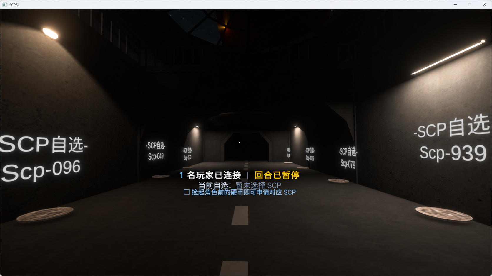

<div align="center">

# LobbyScpSelector

**SCP:SL（LabAPI）开箱即用的开始大厅 + 硬币 SCP 自选插件**

[简体中文](README.md) · [English](README_EN.md)

</div>



## 为什么选择它

- **安装即用，无需配置**：已内置一套完整实测过的大厅出生点、7 个 SCP 硬币位置及文字朝向，装上重启即可直接游玩。
- **零第三方 Hint 依赖**：倒计时与自选状态提示完全基于 LabAPI 原生 `Player.SendHint`，无需 `EXILED` 或 `HintServiceMeow`。
- **硬币上方自动生成 `TextToy` 标签**：生成硬币时自动附带角色名牌；用指令重新放置时文字朝向会自动与玩家视角对齐，并自动覆盖旧位置写回 `config.yml`。
- **开局优先分配与去重**：开局前自动切回 `Spectator`、优先满足已自选玩家，同回合不重复随机角色，默认 7 人以下禁选 `SCP-079`。

---

## 快速安装

仅需 **2 个运行前提**：服务端自带 `LabApi >= 1.1.7` 与 `0Harmony.dll`。

1. 下载 `LobbyScpSelector.dll`（或从源码编译），放入服务端 `LabAPI/plugins/global/`（或指定端口插件目录）。
2. 确保 `0Harmony.dll` 已放在服务端 LabAPI 的 `dependencies/` 目录。
3. 重启服务端即可生效，无需额外配置；首次启动会自动生成默认 `config.yml`。

---

## 可选：游戏内调整点位

默认坐标已可直接开玩；如需微调位置，在管理控制台（RA）输入以下指令即可**自动生效并保存**，无需手动编辑 YAML：

| 指令 | 别名 | 权限 | 说明 |
| --- | --- | --- | --- |
| `scpcoin <scp>` | `scpc`, `scpfoot` | `scpselection.config` | 在脚下地面放置对应 SCP 硬币与上方文字（自动删除旧位置、对齐玩家朝向并保存） |
| `scpcoin <scp> <x> <y> <z>` | `scpc`, `scpfoot` | `scpselection.config` | 在指定世界坐标放置或移动对应 SCP 硬币 |
| `scpcoin remove <scp>` | `scpc`, `scpfoot` | `scpselection.config` | 删除该 SCP 硬币配置并移除实体 |
| `scpcoin list` / `reload` | `scpc`, `scpfoot` | `scpselection.config` | 查看全部配置坐标 / 重载当前大厅硬币 |
| `lobbyspawn set [x y z]` | `setlobbyspawn`, `lspawn` | `lobby.spawn` | 将大厅出生点设为当前位置或指定坐标并保存 |
| `lobbyspawn tp` / `get` | `setlobbyspawn`, `lspawn` | `lobby.spawn` | 传送至大厅出生点验证 / 查看当前坐标 |
| `scpgetpos` | `scpcoord` | `scpselection.position` | 查看自身当前世界坐标 |

> 支持的 `<scp>` 参数：`173`、`049`、`096`、`079`、`3114`、`106`、`939`（不区分大小写，可带 `scp` 前缀）。

---

<details>
<summary>查看默认 config.yml 预设与源码构建命令</summary>

```yaml
is_enabled: true
debug: false
lobby_spawn_position:
  x: -0.09920526
  y: 295.3805
  z: -8.435011
coin_scale: 17
min_players_for_scp079: 7
allow_scp_overflow: true
use_custom_start_queue: true
scp_selection_coin_positions:
  Scp173: { x: -2.656249, y: 294.4705, z: -12.48828 }
  Scp049: { x: 2.300781, y: 294.7761, z: -12.60156 }
  Scp096: { x: 8.140626, y: 294.7, z: -12.27734 }
  Scp079: { x: 3.214844, y: 294.4705, z: -3.140625 }
  Scp3114: { x: -2.425783, y: 294.4705, z: -3.070313 }
  Scp106: { x: -7.792969, y: 294.4705, z: -3.53125 }
  Scp939: { x: 7.660157, y: 295.0731, z: -3.160156 }
scp_selection_coin_label_rotations:
  Scp106: { x: 0, y: 2.469223, z: 0 }
  Scp3114: { x: 0, y: 0.2279663, z: 0 }
  Scp079: { x: 0, y: 6.880295, z: 0 }
  Scp939: { x: 0, y: 7.347214, z: 0 }
  Scp096: { x: 0, y: 180.401, z: 0 }
  Scp049: { x: 0, y: 180.2856, z: 0 }
  Scp173: { x: 0, y: 182.7411, z: 0 }
coin_label:
  enabled: true
  offset: { x: 0, y: 1.2, z: 0 }
  scale: { x: 0.5, y: 0.5, z: 0.5 }
  display_size: { x: 1000, y: 1000 }
  face_lobby_spawn: true
  default_rotation: { x: 0, y: 0, z: 0 }
  text_format: "-SCP自选-\r\n{scp}"
```

从源码构建（`.NET Framework 4.8.1` / `x64`）：

```powershell
dotnet build LobbyScpSelector.csproj -c Release `
  -p:GameManagedDirectory="你的_SCPSL_Data\Managed_路径" `
  -p:PluginDependencyDirectory="你的_0Harmony与Assembly-CSharp-Publicized_目录"
```

> 若此前运行过旧版本，已有 `config.yml` 不会被自动覆盖；删除旧配置后重启即可重新生成上述默认预设。

</details>

---

基于 [MIT License](LICENSE) 开源。

