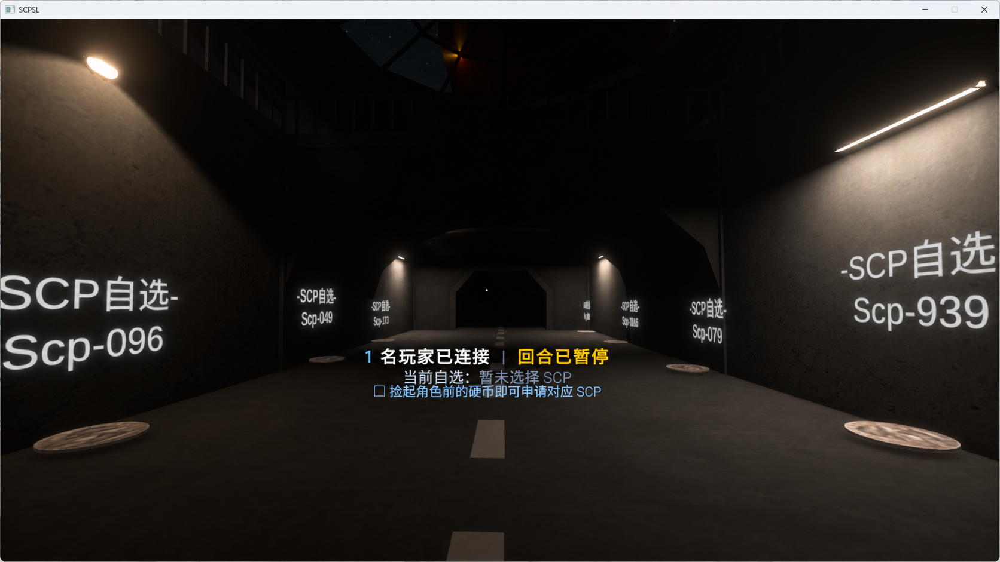

<div align="center">

# LobbyScpSelector

**Out-of-the-Box Pre-Round Lobby & Coin-Based SCP Selection Plugin for SCP:SL (LabAPI)**

[简体中文](README.md) · [English](README_EN.md)

</div>



## Features

- Ships with default coordinates for the lobby spawn, all 7 SCP coins, and label rotations, so it works out of the box without any config edits.
- Uses the game's built-in `Player.SendHint` directly, with no EXILED or HintServiceMeow required.
- Spawns a `TextToy` role label above each coin. Moving a coin with `scpcoin` rotates the label to match where you are looking, removes the old spot, and saves `config.yml` right away.
- Prioritizes players who picked a coin when the round starts, avoids duplicate SCPs until every role is taken, and disables `SCP-079` below `7` players by default.

---

## Quick Install

Only requires **LabAPI (`>= 1.1.7`)** and **`0Harmony.dll`**.

1. Place `LobbyScpSelector.dll` into your server's `LabAPI/plugins/global/` (or port-specific plugins directory).
2. Ensure `0Harmony.dll` is in the LabAPI `dependencies/` folder.
3. Restart the server—default `config.yml` is generated automatically and ready to use with no manual editing.

---

## Optional: In-Game Repositioning

Everything works out of the box. If you want to customize positions later, run these Remote Admin commands to **apply and auto-save** immediately:

| Command | Aliases | Permission | Description |
| --- | --- | --- | --- |
| `scpcoin <scp>` | `scpc`, `scpfoot` | `scpselection.config` | Places the SCP coin and label at your feet (replaces old position, matches your facing, and auto-saves) |
| `scpcoin <scp> <x> <y> <z>` | `scpc`, `scpfoot` | `scpselection.config` | Places or moves the SCP coin to world coordinates |
| `scpcoin remove <scp>` | `scpc`, `scpfoot` | `scpselection.config` | Deletes the SCP coin from config and destroys its entities |
| `scpcoin list` / `reload` | `scpc`, `scpfoot` | `scpselection.config` | Lists all configured positions / reloads lobby coins |
| `lobbyspawn set [x y z]` | `setlobbyspawn`, `lspawn` | `lobby.spawn` | Sets and saves the lobby spawn to your position or coordinates |
| `lobbyspawn tp` / `get` | `setlobbyspawn`, `lspawn` | `lobby.spawn` | Teleports to lobby spawn / prints current spawn position |
| `scpgetpos` | `scpcoord` | `scpselection.position` | Prints your current world coordinates |

> Supported `<scp>` values: `173`, `049`, `096`, `079`, `3114`, `106`, `939` (case-insensitive, optional `scp` prefix).

---

<details>
<summary>View default config.yml preset & build-from-source command</summary>

```yaml
is_enabled: true
debug: false
lobby_spawn_position:
  x: -0.09920526
  y: 295.3805
  z: -8.435011
coin_scale: 17
min_players_for_scp079: 7
allow_scp_overflow: true
use_custom_start_queue: true
scp_selection_coin_positions:
  Scp173: { x: -2.656249, y: 294.4705, z: -12.48828 }
  Scp049: { x: 2.300781, y: 294.7761, z: -12.60156 }
  Scp096: { x: 8.140626, y: 294.7, z: -12.27734 }
  Scp079: { x: 3.214844, y: 294.4705, z: -3.140625 }
  Scp3114: { x: -2.425783, y: 294.4705, z: -3.070313 }
  Scp106: { x: -7.792969, y: 294.4705, z: -3.53125 }
  Scp939: { x: 7.660157, y: 295.0731, z: -3.160156 }
scp_selection_coin_label_rotations:
  Scp106: { x: 0, y: 2.469223, z: 0 }
  Scp3114: { x: 0, y: 0.2279663, z: 0 }
  Scp079: { x: 0, y: 6.880295, z: 0 }
  Scp939: { x: 0, y: 7.347214, z: 0 }
  Scp096: { x: 0, y: 180.401, z: 0 }
  Scp049: { x: 0, y: 180.2856, z: 0 }
  Scp173: { x: 0, y: 182.7411, z: 0 }
coin_label:
  enabled: true
  offset: { x: 0, y: 1.2, z: 0 }
  scale: { x: 0.5, y: 0.5, z: 0.5 }
  display_size: { x: 1000, y: 1000 }
  face_lobby_spawn: true
  default_rotation: { x: 0, y: 0, z: 0 }
  text_format: "-SCP自选-\r\n{scp}"
```

Build from source (`.NET Framework 4.8.1` / `x64`):

```powershell
dotnet build LobbyScpSelector.csproj -c Release `
  -p:GameManagedDirectory="path\to\SCPSL_Data\Managed" `
  -p:PluginDependencyDirectory="path\to\0Harmony_and_Publicized_Assembly_dir"
```

> Existing `config.yml` files are not overwritten automatically; delete any older `config.yml` before restarting to regenerate these defaults.

</details>

---

Licensed under the [MIT License](LICENSE).

